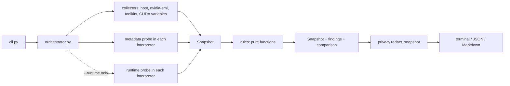

# Architecture

GPU Stack Inspector is split into layers that only talk in one direction. Collectors gather facts, rules turn
facts into findings, renderers turn findings into output. Nothing below the CLI decides what the user wanted, and
nothing above the collectors runs a command.

## Layers

| Layer | Modules | Rule |
| --- | --- | --- |
| CLI | `cli.py` | Parses arguments, chooses what to collect, sets exit codes. No diagnosis. |
| Orchestration | `orchestrator.py` | Runs collectors and probes, attaches findings and the comparison. |
| Collectors | `collectors/` | Read facts; never decide what they mean. A failed probe becomes a `ProbeFailure`, not an exception. |
| Probes | `probes/` | Programs that run *inside* target interpreters, and the code that runs and parses them. |
| Snapshot | `models.py` | Frozen dataclasses. Unknown facts are `None`. |
| Rules | `rules/` | Pure functions of a snapshot: no commands, no files. Registered under stable codes with a docstring. |
| Data | `compatibility/` | Dated, source-tagged NVIDIA compatibility facts. |
| Privacy | `privacy.py` | Redacts the whole snapshot before any renderer sees it. |
| Renderers | `reports/` | Terminal (Rich, never markup from collected text), JSON (schema v1), Markdown (escaped). |

## Inspecting an interpreter without importing its packages

The tool never imports a target environment's packages into its own process. For each `--python` it runs a fixed
program, `probes/metadata_program.py`, as `python -c <source>`:

- in a fresh empty working directory, because `-c` puts the working directory first on `sys.path`;
- with the target's own environment, which is part of what is being diagnosed;
- with an 8 s timeout and capped output.

The program is Python 3.8 syntax and standard library only (CI runs it in 3.8, 3.9, 3.10 and PyPy). It reads
package metadata from disk and prints one JSON document between markers. For torch it collects static evidence
(version tag, `nvidia-*` requirements, the CUDA libraries in `torch/lib`, `torch/version.py` read as text, conda's
package records), which `rules/torch_build.py` turns into a verdict by voting.

Only `probe --runtime` runs `probes/runtime_program.py`, which imports torch and runs a tiny CUDA operation, step by
step, announcing each step so a crash can be attributed.

## Commands

`runner.py` is the only place a subprocess starts: argument lists only, a timeout that kills the whole process
group, capped output, `stdin` closed. Tests replace it with `tests/fakes.FakeRunner`, which fails on any command
it was not told to expect.

## Findings

A rule yields `Finding`s with a code (`GSI-<AREA>-<NNN>`), a status (`pass`, `warn`, `fail`, `unknown`,
`not_applicable`, `not_tested`), evidence, a recommended action, a command to verify it and its limitations. A
consequence names the finding it follows from (`caused_by`), so one missing driver is one problem, not five. Rules
run host first, then interpreters, then compatibility, then the comparison. A rule that raises becomes an
`unknown` "internal error" finding instead of a crash.
